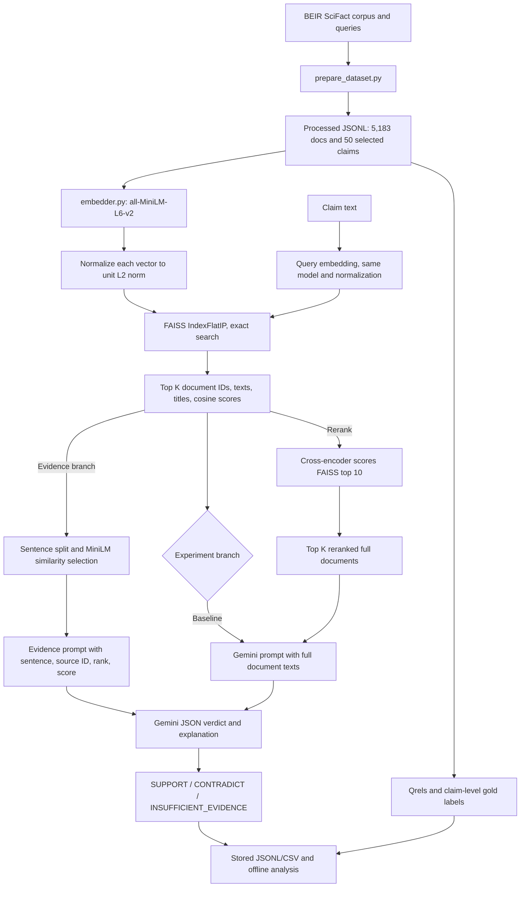

# RAG Retrieval Research Project — Technical Audit

**Audit date:** 2026-11-17
**Scope:** Read-only inspection of repository source, tracked data/configuration, local ignored artifacts, generated experiment outputs, and the active virtual environment.
**Change boundary:** This audit added this report only. Existing files, datasets, local indexes, results, and credentials were not modified or opened for secret values. No experiment or API call was run.

## Executive summary

This is a research prototype for scientific claim verification on SciFact, not a general-purpose RAG application. Its implemented core is a document-level dense retriever over 5,183 SciFact abstracts, followed by Gemini verdict generation. A cross-encoder is applied to only the FAISS top-10 candidates; a later exploratory branch extracts up to six claim-similar sentences before generation.

The main baseline results in `results/rag_metrics_clean.json` and the corresponding 200 JSONL records substantiate the historical Hit@K values: **0.54, 0.70, 0.76, 0.90** at K=1, 3, 5, 10. The full baseline generator run had 200/200 successful calls. The saved canonicalized reranking analysis shows Hit@K gains of +0.08, +0.14, and +0.12 at K=1, 3, and 5; no change at K=10. Verdict accuracy among successful calls was higher in the reranked aggregate at K=1/3/5 and marginally lower at K=10, but Day 2 had 71 failed unique calls and only 40–41 paired successful queries per K. These are descriptive, incomplete-call comparisons—not causal findings.

The benchmark split/sample protocol is a notable validity limitation: the preparation script reads **BEIR SciFact test qrels**, filters to labeled queries with relevant judgments, then creates a balanced 50-query subset named “dev.” The test relevance labels therefore directly determine evaluation inclusion. No training occurs, but the sample is not an independent dev set and its 25/25 label balance is not the natural benchmark distribution.

“Evidence-aware” is implemented as sentence selection and prompt formatting, not as evidence verification. The system does not produce claim-level citations, map answer claims to sources, independently validate support, detect contradictions, score faithfulness, or abstain based on a computed confidence. The Gemini prompt asks for evidence-only answers and an `INSUFFICIENT_EVIDENCE` verdict, but this is an instruction rather than a verifier.

The repository contains useful stored results and analysis scripts, but no automated test suite, dependency lock, pinned model/dataset revisions, complete configuration manifest, per-stage latency, token/cost measurements, or significance tests. The main baseline metrics are verifiable; several secondary metrics were not saved, though ranking metrics can be calculated from the stored query judgments and ranked document IDs. Those calculations are reported below with their definitions.

## Ten most important findings

1. **The reported baseline retrieval Hit@K values are verified** from actual stored evaluation rows: 0.540 / 0.700 / 0.760 / 0.900.
2. **The actual index is `faiss.IndexFlatIP`**, 5,183 vectors of dimension 384, despite its misleading `.ivf` filename. It is an exact flat inner-product index, not IVF.
3. **The corpus is document-level and unchunked.** There is no chunk-size or overlap parameter; each SciFact corpus document is embedded as a single text.
4. **The 50-query sample is a balanced, filtered subset of BEIR test-qrels queries**, not a separately established development split.
5. **Reranking only reorders the initial FAISS top 10.** It cannot recover relevant documents outside that candidate pool; at K=10 it leaves the candidate set unchanged.
6. **Day 2 contains 401 raw rows for 400 unique combinations**, including a duplicate successful `reranked / 1041 / K=10` row. The canonical analysis uses one row per combination and counts 329 successes / 71 failures.
7. **Reranked retrieval gains are supported descriptively**, but the aggregate verdict comparison excludes failures and uses fewer than 50 paired outcomes; it has no confidence intervals or significance tests.
8. **Sentence extraction is similarity-based, with no relevance threshold.** The stored five-query evidence comparison produced identical predictions across full-document and extracted-evidence inputs, but it is too small to establish equivalence.
9. **Citation correctness, claim-to-evidence support, faithfulness, contradiction detection, and confidence-based abstention are not implemented.**
10. **Reproduction is not fully controlled:** requirements are unpinned, model revisions are not recorded, result outputs are inconsistently protected from overwrites, and API generation settings are largely implicit.

## 1. Project structure and inventory

### 1.1 Repository tree

This tree separates tracked source and reference files from local/ignored artifacts. `.git`, the installed `.venv` package tree, bytecode caches, and the full contents of generated result payloads are not expanded.

```text
.
├── .env                                  # ignored; exists locally; secret value not inspected
├── .gitignore
├── FINAL_REPORT.md                       # existing cross-day research report
├── README.md
├── RAG_PROJECT_TECHNICAL_AUDIT.md        # this new audit
├── Research prj.txt                      # pre-existing untracked planning/literature notes
├── requirements.txt
├── data/
│   ├── .gitkeep
│   ├── index/                            # ignored local FAISS artifacts
│   │   ├── faiss_index.ivf
│   │   └── id_map.json
│   └── processed/
│       ├── corpus.jsonl                  # tracked, 5,183 documents
│       ├── dataset_metadata.json         # tracked preparation metadata
│       ├── dev_queries.jsonl             # tracked, 50 selected queries
│       └── raw_scifact/                  # ignored downloaded official release
│           ├── data.tar.gz
│           └── data/
│               ├── corpus.jsonl
│               ├── claims_train.jsonl
│               ├── claims_dev.jsonl
│               ├── claims_test.jsonl
│               └── cross_validation/
│                   ├── fold_1/ ... fold_5/
│                   └── AppleDouble metadata files
├── docs/
│   ├── DAY2_REPORT.md
│   └── DAY3_REPORT.md
├── experiments/
│   ├── .gitkeep
│   ├── analyze_case_studies.py
│   ├── analyze_cases.py
│   ├── analyze_errors.py
│   ├── analyze_evidence_quality.py
│   ├── analyze_ranking.py
│   ├── analyze_reranked_rag.py
│   ├── compare_evidence_extractors.py
│   ├── final_analysis.py
│   ├── plot_reranked_results.py
│   ├── plot_results.py
│   ├── run_evidence_comparison.py
│   ├── run_rag_experiment.py
│   ├── run_reranked_rag_experiment.py
│   ├── test_evidence_extractor.py
│   ├── test_evidence_rag.py
│   ├── test_improved_prompt.py
│   ├── test_rag.py
│   ├── test_reranking.py
│   └── test_retrieval.py
├── notebooks/
│   └── .gitkeep                           # no notebook files found
├── results/                               # ignored; local generated outputs
│   ├── plots/
│   ├── case_study_analysis.{json,txt}
│   ├── day2_final_metrics_table.csv
│   ├── day2_final_summary.txt
│   ├── error_analysis.{jsonl,metrics.json,summary.csv}
│   ├── evidence_comparison.{jsonl,metrics.json,summary.txt}
│   ├── evidence_extractor_comparison.{json,txt}
│   ├── evidence_quality_analysis.{json,txt}
│   ├── evidence_rag_sanity.jsonl
│   ├── final_analysis.{json,csv}
│   ├── final_analysis_summary.txt
│   ├── final_case_studies.json
│   ├── final_case_study_analysis.{json,txt}
│   ├── final_comparison_table.csv
│   ├── improved_prompt_sanity.jsonl
│   ├── interesting_cases.json
│   ├── rag_failure_analysis.json
│   ├── rag_metrics.json
│   ├── rag_metrics_clean.json
│   ├── rag_results.jsonl
│   ├── rag_results_clean.jsonl
│   ├── rag_summary.csv
│   ├── rag_summary_clean.csv
│   ├── ranking_analysis.{json,csv}
│   ├── reranked_comparison.png
│   ├── reranked_improvement.png
│   ├── reranked_rag_analysis.{json,csv}
│   ├── reranked_rag_case_studies.json
│   ├── reranked_rag_checkpoint.json
│   ├── reranked_rag_metrics.json
│   ├── reranked_rag_results.jsonl
│   ├── reranked_rag_summary.csv
│   ├── reranked_retrieval_hit_at_k.png
│   ├── reranked_verdict_accuracy_at_k.png
│   ├── reranking_sanity.{json,csv}
│   ├── retrieval_results.jsonl
│   ├── retrieval_summary.csv
│   └── plots/
│       ├── README.txt
│       ├── retrieval_hit_at_k.png
│       ├── retrieval_vs_verdict.png
│       └── verdict_accuracy_at_k.png
├── scripts/
│   ├── inspect_dataset.py
│   └── stream_corpus_sample.py
└── src/
    ├── __init__.py
    ├── data/
    │   ├── __init__.py
    │   └── prepare_dataset.py
    ├── evaluation/
    │   └── __init__.py                 # no evaluation implementation found
    ├── rag/
    │   ├── __init__.py
    │   ├── diverse_evidence_extractor.py
    │   ├── evidence_extractor.py
    │   ├── evidence_generator.py
    │   ├── generator.py
    │   └── improved_generator.py
    └── retrieval/
        ├── __init__.py
        ├── embedder.py
        └── retriever.py
```

### 1.2 Purpose of files and entry points

| File/group | Actual role |
|---|---|
| `README.md` | Project overview, research questions, reported results, environment variable guidance, and suggested run order. It is descriptive, not an executable configuration. |
| `FINAL_REPORT.md` | Existing Day 1–3 consolidated narrative and result tables. It cites local generated outputs; its claims were cross-checked against those outputs where available. |
| `docs/DAY2_REPORT.md`, `docs/DAY3_REPORT.md` | Focused reranking and evidence-representation writeups. |
| `Research prj.txt` | Untracked background/planning notes. It contains literature discussion and proposed study design, not an authoritative description of implemented behavior or verified results. |
| `requirements.txt` | Unpinned top-level Python dependency names only. There is no lock file, `pyproject.toml`, `setup.py`, or environment YAML in the repository. |
| `src/data/prepare_dataset.py` | Loads BEIR SciFact corpus, queries, test qrels, and original SciFact claim labels; aligns IDs/text, samples a balanced labeled subset, and writes processed data and metadata. |
| `src/retrieval/embedder.py` | Loads the Sentence Transformers model at import time and returns float32, L2-normalized embeddings; default batch size is 64. |
| `src/retrieval/retriever.py` | Loads/builds FAISS index, maps index positions to corpus IDs, embeds queries, searches, and returns document fields plus similarity score. |
| `src/rag/generator.py` | Creates the Gemini client, baseline evidence prompt, JSON-constrained generation request, and minimal output-schema validation. |
| `src/rag/improved_generator.py` | Alternate prompt that asks for document-by-document consideration. It does not add a different model, verifier, or structured evidence-checking algorithm. |
| `src/rag/evidence_extractor.py` | Splits retrieved full text into sentences and selects top claim-similar sentences, capped at two/document and six total. |
| `src/rag/diverse_evidence_extractor.py` | Greedy sentence selection that combines similarity and a binary unseen-document bonus. |
| `src/rag/evidence_generator.py` | Sends extracted sentences, document IDs, ranks, and similarity scores to Gemini; returns the same verdict/explanation schema. |
| `src/evaluation/__init__.py` | Package marker only; no reusable evaluation functions found. Evaluation lives in experiment scripts and generated analyses. |
| `scripts/inspect_dataset.py` | Dataset-discovery/streaming inspection script; despite an older docstring referring to NQ, its actual candidate datasets and output logic target SciFact. |
| `scripts/stream_corpus_sample.py` | Prints three streamed BEIR SciFact corpus examples. |
| `experiments/test_retrieval.py` | Retrieves top 10 once per selected claim, saves rows for each prefix K=1/3/5/10, and summarizes Hit@K. |
| `experiments/test_reranking.py` | Offline cross-encoder sanity evaluation over saved FAISS top-10 ranks; records first-relevant-rank movement, recall-like prefix hit rates, and rankings. |
| `experiments/run_rag_experiment.py` | Sequential baseline Gemini run over 50 queries × K={1,3,5,10}; writes JSONL, CSV, metrics; transient retry/backoff is included. |
| `experiments/run_reranked_rag_experiment.py` | Baseline and cross-encoder conditions over 50 × 4 × 2; resumes using existing keys, appends rows, saves checkpoint and aggregate metrics. |
| `experiments/test_rag.py` | Single-query, four-K manual generation sanity runner; does not save a result file. Whether this script was run is not verified. |
| `experiments/test_improved_prompt.py` | Prompt-only test on the first five queries and four K values, compared to baseline; the saved output has only 16 of 20 planned rows. |
| `experiments/test_evidence_extractor.py` | Local retrieval/reranking/evidence-extraction inspection on five selected queries; no result artifact written. |
| `experiments/test_evidence_rag.py` | Baseline-versus-original-evidence sanity calls for five queries × K={3,5}; saves both conditions, 20 rows in the observed output. |
| `experiments/compare_evidence_extractors.py` | Offline comparison of original and diverse extractors on five queries × two K values; invokes local retrieval/extraction, not Gemini. |
| `experiments/run_evidence_comparison.py` | Three-condition generation experiment (full docs, original evidence, diverse evidence), 5 × 2 × 3 calls; refuses to overwrite the JSONL via exclusive create mode. |
| `experiments/analyze_ranking.py` | Offline first-relevant-rank and prefix-hit analysis. Its `recall_at_k` field is actually the fraction of queries with at least one relevant document retrieved (Hit@K), not qrel recall. |
| `experiments/analyze_errors.py`, `analyze_cases.py`, `analyze_case_studies.py` | Offline error categories and case study reports for baseline or reranked stored outputs. |
| `experiments/analyze_reranked_rag.py` | Deduplicates Day 2 combinations (first row wins), calculates canonical condition/K comparisons and paired successful transitions. |
| `experiments/analyze_evidence_quality.py` | Checks whether extracted evidence came from a qrel-relevant document and summarizes similarity values; does not label sentence-level correctness. |
| `experiments/final_analysis.py` | Offline consolidation and validation of Day 1–3 metrics/case studies into JSON, CSV, and text outputs. |
| `experiments/plot_results.py`, `plot_reranked_results.py` | Plot persisted baseline/reranking metrics and write figures/tables/summaries. |
| `notebooks/` | Contains only `.gitkeep`; no notebook experiment exists in the checked repository. |

### 1.3 Configuration, data, and generated outputs

- **Configuration:** top-level package names are in `requirements.txt`; runtime environment has `.env` locally, ignored by Git. The audit did not inspect its contents. `GEMINI_API_KEY` is read by generator modules via `python-dotenv`; missing key raises at import.
- **Dataset:** processed corpus, query subset, and metadata are tracked. The official raw SciFact archive and extracted corpus/claim splits are present locally but ignored by `.gitignore`.
- **Index:** `data/index/faiss_index.ivf` and `id_map.json` exist locally but are ignored. The index is not regenerated or modified by this audit.
- **Outputs:** `results/` and its contents are ignored. They are present locally, so this report can inspect them, but they are not included in the repository’s tracked source history. This impacts reproducibility for a clean checkout.
- **Dependencies observed in the active `.venv` (Python 3.13.7):** `sentence-transformers 6.0.0`, `faiss-cpu 1.15.0`, `datasets 5.0.1`, `numpy 2.5.2`, `pandas 3.0.5`, `matplotlib 3.11.1`, `python-dotenv 1.2.3`, `google-genai 2.19.0`, `torch 2.13.0`, `transformers 5.15.1`, `huggingface-hub 1.28.0`. These are current local environment versions, not versions pinned or proven to have generated each historical result.
- **Potentially stale/duplicated/experimental content:** `rag_results.jsonl` and `rag_metrics.json` are earlier, incomplete baseline artifacts; `_clean` artifacts are the validated baseline. `test_improved_prompt.py` has a partial 16-row output. `src/rag/improved_generator.py`, dataset inspection scripts, one-query sanity runners, and extractor sanity scripts are exploratory. `src/evaluation` and `notebooks` are placeholders. The `.ivf` filename is misleading for the observed Flat index.

## 2. Technical architecture

### 2.1 Implemented execution path



The three principal paths are baseline retrieval, reranked retrieval, and evidence-sentence input. The reranking and evidence branches are experiment scripts, not a single assembled production service or public API.

### 2.2 Stage-by-stage implementation

| Stage | Implementation and actual behavior | Inputs/outputs and relevant limits |
|---|---|---|
| Dataset loading | `src/data/prepare_dataset.py` uses Hugging Face `datasets.load_dataset` for `BeIR/scifact` corpus/queries, `BeIR/scifact-qrels`, and one of several candidate original SciFact annotation dataset IDs; if those fail it downloads the official archive. | Corpus/query/qrel objects are converted to Python dictionaries, then JSONL. Dataset revision/commit is not pinned. |
| Document extraction | The processed corpus stores `corpus_id`, `title`, and `text`. BEIR corpus records are copied; no PDF/full-text extraction is performed. | Each corpus item is treated as one document. |
| Text normalization | Whitespace is stripped/collapsed and text lowercased only for claim-text alignment in the preparation script. No corpus cleaning, Unicode normalization, boilerplate removal, or case normalization is applied before embedding. | Embedding receives the stored `text` field, not a normalized copy. |
| Chunking | **Not implemented.** The unit of retrieval is the full SciFact corpus entry (typically an abstract). | No chunk size or overlap setting exists. Sentence splitting only occurs downstream in the evidence-extraction experiment. |
| Metadata | `corpus_id`, title, and text are persisted; query JSONL stores query ID, claim, gold label, annotation evidence IDs, qrel relevant corpus IDs, and a count. | Retrieval returns title/text/id/score. The index’s separate ID map maps positions to corpus IDs. |
| Embeddings | `src/retrieval/embedder.py` loads `sentence-transformers/all-MiniLM-L6-v2`; `encode_texts` defaults to batch size 64, converts to float32, and L2-normalizes rows. | Corpus embeddings are generated in one call over all document texts when rebuilding. Query embeddings use the same path. Exact model revision and runtime device are not recorded. |
| Vector index | `src/retrieval/retriever.py` creates `faiss.IndexFlatIP(dim)`, adds normalized embeddings, and serializes the index plus a position-to-ID JSON list. | Observed local index is 5,183 × 384 and reports class `IndexFlatIP`; index filename suffix `.ivf` is inaccurate. |
| Similarity search | Query vector is unit normalized and passed to `index.search(q_emb, top_k)`. For normalized vectors, inner product is cosine similarity. | Returned `similarity_score` is a cosine-like value, not a probability or calibrated relevance confidence. |
| Top-K retrieval | Baseline evaluation uses K={1,3,5,10}. `run_reranked_rag_experiment.py` fetches top 10, then exposes a prefix of K. | No adaptive depth, minimum-score threshold, query filtering, or lexical fallback. |
| Reranking | `CrossEncoder("cross-encoder/ms-marco-MiniLM-L-6-v2")` scores `(claim, document text)` pairs for the FAISS top 10 and sorts descending. | Title is omitted from the pair; no reranker batch/device config is supplied. At most 10 candidates can be reordered. |
| Context selection | Baseline uses all documents in the selected K prefix. Evidence experiments select no more than 2 sentences per document and 6 total. | Full docs are not token-budgeted or compressed; evidence selection has no minimum similarity cutoff. |
| Prompt construction | Baseline prompt includes claim and numbered docs with title and text. Evidence prompt includes document ID/rank/similarity/sentence. | The prompt text asks for only supplied evidence and an insufficient-evidence option. No hard context limit/token counter is implemented. |
| LLM generation | `src/rag/generator.py` calls `google.genai.Client.models.generate_content` with model string `gemini-3.5-flash-lite` and `response_mime_type="application/json"`. | Temperature, top-p, seed, max output tokens, safety settings, timeout, and API version are not specified in code. Effective defaults are therefore provider/client dependent. |
| Parsing and final output | `json.loads(response.text)` then verifies verdict is in a fixed three-label set and explanation is a string. Experiments persist prediction, explanation, IDs, and status. | There is no parser for claim-level citations and no guarantee that explanation text is entailed by sources. |

## 3. Dataset analysis

### 3.1 Dataset identity and measured inventory

The processed metadata names the source as **“BEIR SciFact (aligned to scifact)”** and identifies Hugging Face sources `BeIR/scifact`, `BeIR/scifact-qrels`, and `scifact`. The metadata records:

- 5,183 corpus documents.
- 1,109 BEIR queries.
- 339 qrel records in the selected `test` split.
- 1,409 original SciFact claims loaded.
- 300 aligned BEIR test queries; 0 failed alignments.
- 50 selected claims with seed 42.

The metadata timestamp is 2026-08-22. **Dataset revision/version hash is Not Found.** The runtime downloader resolves the dataset identifier without a revision argument; current files therefore cannot by themselves identify the exact upstream snapshot.

### 3.2 Loading, filtering, and representation

The script loads BEIR `corpus` and `queries`, then selects the `test` qrels split when available. It aligns query IDs to original SciFact claims first by ID and then by normalized exact claim text. When the original annotation dataset has multiple splits, the code concatenates all of them into a claim lookup; it does not use them to train a model. Original evidence annotations are mapped to `SUPPORT`, `CONTRADICT`, `AMBIGUOUS`, or unlabeled. It selects only `SUPPORT`/`CONTRADICT` records with at least one qrel-relevant corpus ID.

The resulting `dev_queries.jsonl` has 50 claims: 25 SUPPORT and 25 CONTRADICT. The sample contains 58 unique qrel-relevant document assignments: 43 claims have one, 6 have two, and 1 has three. Stored fields are:

- `query_id`, `claim_text`, `ground_truth_label`
- `evidence_doc_ids` (from original claim annotation)
- `relevant_corpus_ids` and `relevant_document_count` (from BEIR qrels)

The full corpus JSONL stores `corpus_id`, `title`, and `text`. Relevance judgments are binary at evaluation time: any overlap between retrieved IDs and `relevant_corpus_ids` counts as a retrieval hit. The qrel grade is not propagated, and labels are separate from document relevance.

### 3.3 Split integrity and validity risks

- Despite the filename `dev_queries.jsonl`, the script uses the **BEIR test qrels split**. It does not create an official SciFact development split.
- The chosen sample is explicitly conditioned on having a relevant qrel and a known binary claim label, then balanced to 25/25. This removes unlabeled/ambiguous/no-qrel queries and changes the natural class/sample distribution.
- This is not model-training leakage, but it is test-set reuse for sample construction. Any claim of benchmark-generalizable performance should use an untouched, pre-specified evaluation set.
- The report does not verify whether any of the claims were used during prompt/model selection or manual experiment iteration. **That history is Not Verified.**
- The five-query Day 3 subset is purposively enumerated by IDs, not randomly sampled.
- Query/document independence, duplicate abstracts, source-level grouping, and possible near-duplicate leakage were not tested.

## 4. Retrieval and embedding implementation

### 4.1 Model, dimensions, and normalization

The source specifies `sentence-transformers/all-MiniLM-L6-v2`. The loaded FAISS index confirms embedding dimension **384**. The embedding function casts vectors to float32 and divides each by its L2 norm; zero norms are left unchanged to avoid division by zero. Query vectors take the same normalization path.

The index artifact stores the vectors, but no model revision, tokenizer revision, embedding cache manifest, maximum sequence length, or input truncation report is stored. The default Sentence Transformers/tokenizer behavior applies; an exact maximum input length for the run is **Not Verified** from project configuration.

### 4.2 Index and scoring

The index is constructed as `faiss.IndexFlatIP(dim)`. The on-disk artifact was read during the audit and confirmed as:

- Type: `IndexFlatIP`
- Dimension: 384
- Indexed vectors: 5,183
- Metric: inner product
- Trained: true (Flat index reports trained; no training phase is required)

Because vectors are unit-normalized, inner-product scores equal cosine similarity (subject to floating-point rounding). Similarity scores are signed similarity scores, not calibrated probabilities. `faiss-cpu` is in the dependency list and the observed index is CPU-backed; GPU execution is not established.

`Retriever.retrieve()` returns exactly the valid FAISS result prefix and looks up each document by corpus ID. The current implementation’s `next(...)` search through the entire Python corpus for every returned ID is a linear lookup per hit; it is correct at the current small scale but unnecessary O(N) work per retrieved document. Index and ID-map compatibility is not validated against the loaded corpus length/order/version. A corrupt/unreadable index falls back to rebuilding under a broad exception handler.

### 4.3 Depths and available ranking metrics

The code tests K=1, 3, 5, and 10. The baseline outputs store top-10 ranked IDs and scores; Day 2 outputs store retrieved IDs for each K in both conditions. No explicit retrieval batch size is used for claims. Corpus embedding batch size is 64. Corpus indexing is exact, with exhaustive inner-product search rather than approximate nearest neighbors.

The following additional metrics were calculated offline from the stored ranked IDs and `relevant_corpus_ids` for the same 50 queries. These are **derived in this audit**, use binary qrels, and are not found as saved primary project metrics. Precision averages hits divided by K; Recall averages retrieved relevant qrel documents divided by all relevant documents for that query; MRR is reciprocal rank of the first relevant document; MAP@K uses denominator `min(number of judged relevant documents, K)`; nDCG@K uses binary relevance and logarithmic rank discount.

| Condition | K | Hit@K | Precision@K | Recall@K | MRR@K | MAP@K | nDCG@K |
|---|---:|---:|---:|---:|---:|---:|---:|
| Baseline | 1 | 0.540 | 0.540 | 0.507 | 0.540 | 0.540 | 0.540 |
| Baseline | 3 | 0.700 | 0.247 | 0.673 | 0.610 | 0.583 | 0.613 |
| Baseline | 5 | 0.760 | 0.164 | 0.740 | 0.625 | 0.602 | 0.642 |
| Baseline | 10 | 0.900 | 0.098 | 0.870 | 0.645 | 0.622 | 0.688 |
| Reranked | 1 | 0.620 | 0.620 | 0.597 | 0.620 | 0.620 | 0.620 |
| Reranked | 3 | 0.840 | 0.287 | 0.793 | 0.727 | 0.695 | 0.729 |
| Reranked | 5 | 0.880 | 0.184 | 0.843 | 0.737 | 0.709 | 0.751 |
| Reranked | 10 | 0.900 | 0.098 | 0.870 | 0.740 | 0.717 | 0.763 |

**Metric naming caution:** `results/ranking_analysis.json` stores values under `recall_at_k` that equal Hit@K (query-level indicator that at least one relevant document appears). It does not compute standard qrel Recall@K. The table above recomputes document-level Recall@K from the stored full qrel sets.

## 5. Reranking implementation

- **Model:** `cross-encoder/ms-marco-MiniLM-L-6-v2` in source. Model/revision is not pinned.
- **Candidate construction:** `(claim, document["text"])` for each of the FAISS top 10. Document title is not included in the CrossEncoder pair.
- **Scoring:** `CrossEncoder.predict(pairs)` returns a scalar score for each pair. The code sorts descending and carries original FAISS rank and score.
- **Depth:** exactly 10 initial candidates, with output prefixes at K=1/3/5/10. No reranking outside this candidate set.
- **Throughput/device:** neither `batch_size` nor `device` is passed to the CrossEncoder. Scoring 50 claims × 10 candidates = 500 document pairs is implied by the offline ranking analysis; measured reranking wall time is **Not Found**.
- **Score interpretation:** scores are used only for within-query ordering, not calibrated as relevance probabilities.

The cross-encoder improves the prefix ordering but cannot retrieve a document missed by FAISS top 10. At K=10 the document set is identical to the FAISS candidate set, explaining unchanged Hit@10/Recall@10; ranking-sensitive MRR/MAP/nDCG can still change, as the audit-derived table shows.

## 6. LLM and generation pipeline

### 6.1 API and model

`src/rag/generator.py` loads `.env`, reads `GEMINI_API_KEY`, and constructs `google.genai.Client`. The source model name is **`gemini-3.5-flash-lite`**. The installed local client version is `google-genai 2.19.0`; there is no record of the backend model revision/API version used for individual calls. Model availability or server-side implementation identity is **Not Verified** by this offline audit.

### 6.2 Prompt and result format

The baseline prompt supplies:

1. The claim.
2. Numbered documents with title and full text (or a “no retrieved evidence” fallback).
3. Instructions to use only retrieved evidence, avoid outside knowledge/invented facts, and use `INSUFFICIENT_EVIDENCE` when support or contradiction is unclear.
4. A JSON schema with `verdict` and short `explanation`.

The request sets only `response_mime_type="application/json"`. No project configuration sets temperature, top-p, token cap, seed, or timeout. Effective generation defaults are **Not Verified**. No context token accounting or prompt clipping is implemented.

The result parser loads `response.text`, validates one of three verdict strings and a string explanation, and raises `ValueError` for malformed JSON/schema. There is no retry inside the generator itself; retry policy is implemented in individual experiment scripts.

### 6.3 Evidence, citations, and grounding

The evidence prompt formats extracted sentences with source corpus ID, document rank, and similarity. The final output schema still includes only verdict and explanation. It does not return citation IDs, sentence offsets, or a claim-to-source mapping. The model may mention evidence in prose, but citation correctness is not mechanically evaluated.

The implementation therefore **asks** Gemini to ground its answer in context; it does not independently verify that an explanation is entailed by retrieved text. There is no faithfulness/hallucination judge, claim decomposition, contradiction evaluator, support threshold, or automated abstention calibration.

### 6.4 API and failure handling

- The baseline runner retries exceptions whose text contains selected transient markers (429/rate limit/resource exhausted/temporary/timeout/5xx) up to three retries with exponential waits. Other exceptions become failed rows.
- The reranked runner identifies quota errors, applies fixed or parsed retry delays for temporary limits, and stops on daily quota/exhausted temporary retry conditions. It appends output and resumes by combination key.
- On resume, all existing keys—including records with `api_success=False`—are treated as completed and skipped. Thus failed combinations are not automatically retried on a subsequent invocation.
- The evidence comparison allows one retry for rate-limit-like errors and writes each condition result.
- API costs, usage tokens, provider request IDs, exact per-call latency, and model response metadata are not logged.

## 7. Experiments and evaluation

### 7.1 Stored experiment inventory

| Experiment | Implemented configuration | Observed result / artifact status |
|---|---|---|
| Dataset preparation | BEIR SciFact; test qrels; align claims; seeded balanced 50-query subset | `dataset_metadata.json`: 5,183 corpus docs; 300 aligned queries; 50 selected; 25 SUPPORT/25 CONTRADICT. |
| Retrieval evaluation | 50 queries; exact dense top-10 ranking; prefixes K=1/3/5/10 | `retrieval_results.jsonl` has 950 rows (prefixes sum to 19 rows/query); `retrieval_summary.csv` has 50 query summaries. |
| Earlier baseline run | 50 × four K values; Gemini | `rag_results.jsonl` has 200 records; `rag_metrics.json` records 168 successful and 32 failed calls. Older/incomplete artifact. |
| Clean baseline RAG | 50 × four K values; dense retrieval + Gemini | 200/200 successful calls; authoritative clean metrics saved. |
| Reranking sanity | 50 claims × top 10 FAISS candidates; local CrossEncoder only | 500 candidate scores; `reranking_sanity.json` includes 50 query analyses and rank summaries; no Gemini calls in this check. |
| Baseline vs reranked RAG | 50 × four K × two conditions = 400 intended unique combinations | 401 raw rows; 400 unique combinations; one duplicate successful row for reranked query 1041/K=10; 329 unique successes, 71 unique failures. |
| Evidence RAG sanity | Five selected claims × K={3,5} × baseline/evidence inputs | `evidence_rag_sanity.jsonl`: 20 records (10 per condition); this artifact is a sanity comparison, separate from the final 30-call three-condition comparison. |
| Evidence quality diagnostic | 10 evidence-aware records from the five-claim K=3/5 sanity set | 5/10 selected sentence sets include a qrel-relevant document; average six sentences/record. Document-level representation does not validate sentence correctness. |
| Original vs diverse selection | Five selected claims × K={3,5}; no Gemini | Relevant-document representation 2/5 at K=3 and 3/5 at K=5 for both. Average unique docs at K=5: 4.2 original, 5.0 diverse. |
| Three-way evidence generation | Five selected claims × K={3,5} × full/original/diverse | 30/30 calls succeeded. All three conditions had accuracy 0.20 at K=3 and 0.40 at K=5; predictions matched full documents for all 10 query/K cases. |
| Improved-prompt sanity | Source plans for first five claims × four K (20); alternative prompt only | Saved `improved_prompt_sanity.jsonl` has 16 records, not 20. In the 16 present rows, accuracy is 10/16=0.625 and predictions are unchanged versus the paired baseline. Completeness and why execution stopped are Not Verified. |
| Single-query generation sanity | First query × four K | `test_rag.py` can run four Gemini calls; no corresponding dedicated output file exists. Whether run is Not Verified. |
| Evidence extractor local sanity | Five claims, FAISS top-10 then CrossEncoder rerank and extraction | Script prints results but does not save an artifact. Execution is Not Verified. |
| Offline analyses/plots | Saved results only | Ranking, error, case-study, final-analysis JSON/CSV/TXT and plots exist. They do not establish additional model experiments. |

### 7.2 Baseline results and historical-value verification

The historical baseline Hit@1/3/5/10 values exactly match `rag_metrics_clean.json`: **0.540 / 0.700 / 0.760 / 0.900**. Clean baseline verdict accuracy among successful calls is 0.620 / 0.720 / 0.740 / 0.800. All 200 calls succeeded in the clean run. The separate earlier `rag_metrics.json` is incomplete and has materially lower accuracy (0.54 / 0.56 / 0.64 / 0.64 over its successful calls); it should not be mixed into the clean baseline.

### 7.3 Reranking comparison

Canonical values below come from `reranked_rag_analysis.json`, which takes one row per unique `(condition, query_id, K)` key and excludes failed API calls from verdict accuracy:

| K | Baseline Hit@K | Reranked Hit@K | Hit delta | Baseline verdict accuracy (successful calls) | Reranked verdict accuracy (successful calls) | Verdict delta | Successful baseline / reranked |
|---:|---:|---:|---:|---:|---:|---:|---:|
| 1 | 0.540 | 0.620 | +0.080 | 0.619 | 0.707 | +0.088 | 42 / 41 |
| 3 | 0.700 | 0.840 | +0.140 | 0.738 | 0.780 | +0.042 | 42 / 41 |
| 5 | 0.760 | 0.880 | +0.120 | 0.732 | 0.756 | +0.024 | 41 / 41 |
| 10 | 0.900 | 0.900 | +0.000 | 0.805 | 0.800 | -0.005 | 41 / 40 |

Day 2 had 71 failed unique generation calls. Verdict accuracy is conditional on successful calls; the numerator/denominator is not the full 50-query set. The stored analysis has 41 paired successful queries at K=1/3/5 and 40 at K=10. Counts of baseline-wrong→reranked-correct vs baseline-correct→reranked-wrong are 4/0, 3/1, 2/1, and 1/1 respectively. This is not a significance test and does not establish that reranking caused any change.

The raw `reranked_rag_results.jsonl` has one duplicate successful row (`reranked`, query `1041`, K=10). Thus it has 401 rows and 330 success rows at raw-row level, while canonical unique combinations have 329 successes and 71 failures. `reranked_rag_analysis.json` explicitly identifies/deduplicates the extra row. The saved `reranked_rag_metrics.json` summary reports 329 successful / 71 failed API calls; raw-row and unique-combination counts must not be conflated.

### 7.4 Evidence and prompt experiments

The final evidence comparison has 30 successful calls across three representations for five claims and K=3/5. Accuracy was 0.20 for all representations at K=3 and 0.40 at K=5. The 10 paired query/K predictions exactly match across full, original, and diverse evidence conditions. A five-query comparison cannot establish statistical equivalence or general ineffectiveness.

The improved-prompt artifact has 16 rows, with 0 changed predictions in those rows. This is a partial sanity test, not a complete 20-row ablation. There is no saved systematic result for whether the prompt improves faithfulness or explanation support.

### 7.5 Available/missing metrics and methods

- **Available as stored project results:** Hit@K, generator verdict accuracy, per-class accuracy, successful/failed API counts, basic rank distribution, evidence-representation comparisons, and selected case studies.
- **Derived in this report:** binary-qrel Precision@K, document-level Recall@K, MRR@K, MAP@K, and nDCG@K for baseline and reranked rankings (see Section 4.3).
- **Not Found:** claim-level precision/recall/F1 for verdict classification, calibration, faithfulness, citation precision/recall, answer relevance, sentence-level evidence precision, latency distributions, tokens/cost, or confidence intervals.
- A “retrieval hit” uses any qrel match and does not measure the correctness of all retrieved documents. High Hit@K at large K is expected to increase as the pool grows, while precision falls.

## 8. Evidence-aware RAG capability audit

| Capability | Status | Evidence |
|---|---|---|
| Retrieve source documents | Implemented | FAISS returns corpus IDs and texts. |
| Select claim-similar evidence sentences | Implemented, heuristic | Sentence embeddings and cosine similarity; maximum 2 per document/6 total. |
| Diversity-aware evidence selection | Implemented, exploratory | Greedy score = `0.7 × similarity + 0.3 × unseen-document indicator`. |
| Minimum evidence relevance threshold | Not implemented | No similarity cutoff; even low-score sentences may be selected to fill the cap. |
| Evidence metadata in prompt | Implemented | Evidence prompt includes source ID, original document rank, score, sentence. |
| Claim-to-evidence mapping | Not implemented | No extracted claim units or structured support links. |
| Citation output | Not implemented | Final JSON contains only `verdict` and `explanation`. |
| Citation correctness evaluation | Not implemented | No citation matching or entailment checks. |
| Unsupported-claim detection | Not implemented | Prompt requests evidence-only output but no independent checker exists. |
| Contradiction detection across evidence | Prompt instruction only | Generator asks to decide support/contradiction; no explicit pairwise contradiction algorithm exists. |
| Faithfulness evaluation | Not implemented | No human or automated faithfulness metric/judge is present. |
| Answer abstention | Partial, generative only | `INSUFFICIENT_EVIDENCE` is an allowed label prompted from Gemini; no confidence threshold or verified abstention rule. |
| Confidence estimation | Not implemented | Similarity values are retrieval scores, not answer confidence. |

The extractors rank semantic similarity to the claim, which is not the same as evidentiary support. Similarity can prioritize a sentence that mentions the topic but does not prove or refute the claim. In the 10-record quality diagnostic, only five selected sets contained a qrel-relevant document; even those five are document-level matches, not validated evidence sentences.

## 9. Performance and computational analysis

### 9.1 What is measured

- Clean baseline runner stores a total `runtime_seconds` of **1,282.11 seconds** for the run. This includes all four K conditions, API calls, setup, and a five-second sleep after each successful call; it is not retrieval or generation latency per request.
- Day 2 `reranked_rag_metrics.json` records **131.56 seconds**, but the reranking runner’s timer starts at each invocation while aggregate result rows can include earlier resumed data. Therefore this value is not a dependable end-to-end duration for all 400 combinations.
- Day 2 has 500 cross-encoder pair scores implied by the 50×10 offline ranking analysis; no isolated reranking timing is saved.
- No per-query FAISS latency, embedding throughput, index-build duration, Gemini latency, memory profile, GPU utilization, or API cost/token measurement was found.

### 9.2 Storage and scale

Observed artifact sizes: corpus JSONL 8,041,571 bytes; FAISS index 7,961,133 bytes; ID map 60,308 bytes. A 5,183 × 384 float32 matrix is about 7.6 MiB before FAISS overhead, consistent with the Flat index artifact size. This is a disk-size calculation, not a process memory measurement.

The exact Flat index is appropriate for this small corpus and offers reproducible exhaustive ranking. It scales linearly with corpus vectors and query scanning; larger corpora would require measured optimization or an approximate index. The current linear Python corpus lookup after FAISS search is also a local performance inefficiency. No production-scale throughput claim is supported.

### 9.3 External requirements

Running generation requires an external Gemini API key, network connectivity, quota, and API availability. First-time dataset/model resolution may require Hugging Face network access and cached model downloads. CPU/GPU availability and the device selected by Sentence Transformers/CrossEncoder are not fixed or logged. The generator is an external, versioned dependency and its defaults may change independently of the repository.

## 10. Code quality and reproducibility

### 10.1 Organization and robustness

The project has a simple package layout for data, retrieval, and generation, but evaluation logic is duplicated among scripts rather than exposed through a stable evaluator. `src/evaluation` is empty. Scripts rely on hardcoded paths relative to repository root, fixed model IDs, fixed K values, and fixed result paths; there is no central config object or CLI configuration beyond the reranking preflight switch.

Potential failure points observed in source:

- The FAISS index filename says `.ivf`, but the actual loaded object is Flat. This can mislead readers/operators.
- A saved index is loaded with an ID map and corpus but no corpus hash, embedding model revision, count/order assertion, or freshness validation. A stale index/ID map can silently return wrong IDs if data changes.
- On index load errors, a broad catch triggers a rebuild and may conceal the original load failure. The code does not record why the old artifact failed.
- Retrieval performs a linear `next(...)` scan over the corpus for each hit.
- Baseline and prompt sanity scripts open outputs in `"w"` mode, so reruns overwrite prior outputs. The reranking experiment appends, allowing duplicate rows; evidence comparison uses `"x"` and refuses an existing output.
- Reranking resume treats any existing key as complete, including API failure records, so subsequent resume does not retry failed calls.
- The improved prompt output is incomplete (16/20). It is not clear from stored artifacts whether this is interruption, quota, or another cause.
- Dataset preparation catches broad exceptions across several dataset IDs, falls back to archive download, and uses `tarfile.extractall`; extraction safety against an unexpected archive is not checked. Its selected file paths and source are fixed, but no upstream revision/checksum is persisted.
- Importing the embedder eagerly loads the model. Importing the generator eagerly requires a configured API key, which can make unrelated imports of the RAG package fail without credentials.
- Evidence sentence splitting is a small punctuation regex and does not handle abbreviations, decimals, or scientific formatting robustly.

### 10.2 Reproducibility

- The subset-selection seed is 42, but the output alone does not capture the upstream dataset commit/version.
- `requirements.txt` does not pin package versions. The `.venv` environment is local and ignored; no lockfile or environment export is tracked.
- Model IDs are strings, but revisions are not fixed for embedding or CrossEncoder weights.
- Gemini output settings are unspecified beyond JSON MIME type; no deterministic seed or provider revision is stored.
- The project stores query IDs, retrieved document IDs, scores in baseline records, and generated predictions, which is useful for offline analysis. It does not consistently store prompt/model revision, request ID, exact token count, runtime by stage, or full reranked candidate scores at every relevant artifact.
- Result files are ignored by Git. A clean clone will not include the local authoritative outputs or local index; current reports refer to artifacts that are not version-controlled.
- No pytest/unittest suite or CI configuration was found. Files beginning with `test_` are experiment/sanity scripts, some of which call external APIs or write output files; they are not isolated, deterministic unit tests.

### 10.3 Security and secrets handling

`.env` is ignored, and source reads `GEMINI_API_KEY` from the environment rather than embedding its value. This audit did not inspect or disclose the key. `test_rag.py` prints only whether a key was detected, not the key itself. The project still depends on local operator discipline to keep `.env` out of commits; no secret-scanning check is configured in the inspected repository.

## 11. Research contribution and novelty

### 11.1 Research question and hypothesis

The repository frames the problem as how retrieval depth affects SciFact claim-verdict accuracy, whether cross-encoder reranking improves ordering, whether ordering changes downstream verdicts, and whether sentence-level evidence representation changes model outputs. The planning notes propose the hypothesis that more context can initially help but excessive context may distract; this is a plausible hypothesis, not a result established by code.

### 11.2 What the experiments establish

Under this specific 50-query sample and selected models:

- Dense retrieval Hit@K rises with K from 0.54 to 0.90.
- Clean baseline verdict accuracy rises overall from 0.62 to 0.80 across these K values.
- Cross-encoder ordering improves observed prefix hit rates at K=1/3/5; hit rate is unchanged at K=10.
- Reranked verdict accuracy among successful calls is descriptively higher at K=1/3/5 and lower by about 0.005 at K=10.
- The three evidence representations produced identical predictions in a five-query, two-K sample.
- The diverse extractor represents more unique documents at K=5 in the small diagnostic but does not improve the share of cases representing a relevant document.

These are reproducible observations from stored outputs. They are not causal evidence that increasing K or reranking improves correctness, nor evidence of broad generalization.

### 11.3 Contribution and paper readiness

The current contribution is a small controlled engineering study with useful component-level logs and exploratory analyses. Its novelty is **limited and not established as a novel retrieval method**: MiniLM dense search, FAISS Flat, a standard MS MARCO cross-encoder, and similarity-based sentence selection are established techniques. The potential contribution is empirical and task-specific—observing how depth/reranking relate to retrieval and verdict outcomes on a selected SciFact subset.

The current evidence is not sufficient for a strong research-paper claim because:

- Sample selection is filtered/balanced from test qrels, with only 50 queries.
- Day 2 has 71 failed unique generations and unmatched denominators.
- Only one seed/model/dataset/prompt setup is represented.
- No statistical significance or uncertainty estimation was run.
- No gold evidence-sentence annotations or faithfulness judgments exist.
- “Evidence-aware” is not evaluated for claim-level citation correctness or support.
- No latency/cost trade-off or controlled token-budget comparison exists.
- Baseline and reranked output can be affected by Gemini generation variability.

For a submission, preregister a protocol on a proper held-out set, report exact data/model snapshots and all failures, use complete paired runs or an explicit missingness method, repeat generation where stochastic, report confidence intervals and paired tests, include stronger baselines/ablations, and human-annotate evidence/faithfulness for a defensible sample. Novelty should be framed as a careful empirical analysis unless a genuinely new method is added and compared.

## 12. Current limitations

1. Small, selected sample; the label balance is imposed by the preparation code.
2. Evaluation subset derives from test qrels and is called “dev.”
3. Document-level abstracts only; no chunking or passage retrieval.
4. Single embedding model and one reranker, no sparse/hybrid baseline.
5. Reranker candidate recall is bounded by dense top-10.
6. No calibrated relevance threshold, adaptive K, or context budget.
7. Generation uses an external model with unspecified decoding settings.
8. Generator verdict accuracy is not faithfulness or citation accuracy.
9. Reranking generation results include substantial quota failures and a duplicate raw row.
10. Day 3 and prompt tests are exploratory, underpowered or partial.
11. Standard qrel recall was not saved; one stored “recall_at_k” label actually means Hit@K.
12. No significance tests, confidence intervals, repeated runs, latency decomposition, memory profile, or cost analysis.
13. Dependencies and upstream model/data revisions are unpinned.
14. Local results and index are ignored, limiting clean-clone reproduction.

## 13. Prioritized improvement roadmap

Complexity and research value are qualitative estimates; proposals below are not implemented.

| Priority / category | Improvement | Current limitation | Proposed solution | Expected benefit | Complexity | Research value |
|---|---|---|---|---|---|---|
| P0 — Reproducibility | Freeze data, dependency, and model revisions | Dataset/model IDs float; requirements unpinned | Pin package versions and Hub dataset/model commit hashes; store manifests/checksums per run | Same inputs and weights can be reconstructed | Low–medium | Foundational |
| P0 — Evaluation integrity | Replace filtered test-derived subset | 50 balanced queries selected from test qrels | Use official dev for iteration and an untouched, pre-specified test set; retain full label distribution | Removes sample-selection contamination and improves external validity | Medium | High |
| P0 — Data/results integrity | Make runs immutable and deduplicated | Some scripts overwrite; Day 2 has one duplicate; failed keys are skipped on resume | Unique run IDs, atomic writes, unique-key validation, explicit retry status and append-only manifests | Prevents silent loss/double counting and enables full paired comparisons | Medium | Foundational |
| P0 — Statistical rigor | Paired uncertainty/significance | No confidence intervals/tests; conditional denominators | Complete paired comparisons; bootstrap by query and use paired tests (e.g. McNemar for binary correctness); report effect sizes and missingness | Distinguishes stable improvements from noise | Medium | High |
| P1 — Metrics | Standardize retrieval and task metrics | Hit@K named recall in one analysis; no uncertainty | Central evaluator with Hit, P/R, MRR, MAP, nDCG and macro/weighted verdict metrics; publish definitions | Accurate comparison and clearer diagnosis | Low–medium | Medium |
| P1 — Retrieval baselines | Add BM25 and hybrid retrieval | Dense-only comparison | Compare BM25, dense, and rank-fusion hybrid on same corpus/query set and candidate budget | Tests lexical complementarity, especially scientific terminology | Medium | High |
| P1 — Retrieval depth | Tune depth under a fixed context budget | Only K=1/3/5/10; no token-aware control | Evaluate wider K and token budgets; report recall and verdict quality against context size/cost | Finds useful quality/latency operating point | Medium | High |
| P1 — Reranking | Test deeper candidates and stronger rerankers | One MS MARCO reranker on top 10, which may miss evidence | Sweep candidate depth separately from final context K; compare domain-relevant cross-encoders/late-interaction models | Separates candidate recall from reranking quality | Medium–high | High |
| P1 — Evidence quality | Introduce evidence annotations and evaluation | Similarity is proxy for evidence; no sentence truth labels | Annotate relevant/supporting/contradicting sentences; measure sentence precision/recall and inter-annotator agreement | Validates whether selection identifies evidence rather than topical text | High | High |
| P1 — Evidence-grounded output | Claim-level citations and verification | Prompt-only grounding; no citation schema/checker | Ask for sentence IDs per claim, validate IDs, then run entailment/contradiction checks and reject unsupported claims | Auditable source attribution and measurable faithfulness | High | High |
| P1 — Hallucination and abstention | Calibrate answer confidence/abstention | LLM chooses insufficient evidence without calibrated threshold | Define evidence sufficiency signals and evaluate selective accuracy/coverage and unsupported-claim rate on human labels | Reduces unsupported outputs and quantifies risk | High | High |
| P2 — Embeddings | Compare stronger/domain-adapted retrievers | One 384-d general model | Benchmark several recent retrieval models on the same judged set; pin revisions and evaluate recall/cost | May improve candidate quality | Medium | Medium–high |
| P2 — Query processing | Query expansion or decomposition | Direct claim embedding only | Compare controlled, logged query transformations against direct retrieval; avoid adding unverified terms | Could improve terminology mismatch | Medium | Medium |
| P2 — Context compression | Evidence selection and diversity | Up to six sentences via heuristic, no threshold | Compare extractive evidence, reranked passages, and token-aware compression with matched token budgets | Reduces context noise and cost | Medium–high | High |
| P2 — Performance/cost | Stage-level benchmark | Only coarse aggregate runtime | Time corpus embed/index, query encode/search, reranking, API latency; log tokens, retries, cost, CPU/GPU and memory | Enables measurable deployment trade-offs | Low–medium | Medium |
| P2 — Generalization | Add benchmark datasets/tasks | Only SciFact | Replicate fixed protocol on additional scientific claim/QA datasets with separate data manifests | Tests whether observed effects generalize | High | High |
| P3 — Engineering | Optimize ID lookup and index validation | O(N) corpus scan per retrieved result; no freshness check | Maintain ID→document map and validate dimension/count/model/corpus hashes when loading | Safer and faster local retrieval | Low | Low–medium |

**Quick engineering improvements:** pin artifacts; validate index/ID-map consistency; prevent accidental overwrites; deduplicate run keys; retry failed keys explicitly; correct the recall naming; centralize evaluation formulas; add stage timers.
**Genuine research contributions:** controlled depth-versus-token-budget experiments; candidate recall/reranker interaction studies; evidence selection validated against human-labeled support spans; claim-level citation and abstention evaluation; replicated results with uncertainty across datasets/models.

## 14. Important source and result references

### Source

- `src/data/prepare_dataset.py` — dataset ingestion, alignment, filtering, sampling, output generation.
- `src/retrieval/embedder.py` — model loading, batch size, normalization.
- `src/retrieval/retriever.py` — FAISS index, persistence, search, result formatting.
- `src/rag/generator.py` — baseline prompt, Gemini API call, response validation.
- `src/rag/improved_generator.py` — alternate prompt-only variant.
- `src/rag/evidence_extractor.py` and `src/rag/diverse_evidence_extractor.py` — sentence selection algorithms.
- `src/rag/evidence_generator.py` — evidence prompt and generation schema.
- `experiments/run_rag_experiment.py`, `experiments/run_reranked_rag_experiment.py` — primary generation experiments.
- `experiments/test_retrieval.py`, `experiments/test_reranking.py` — retrieval/rerank metrics and rank analyses.
- `experiments/run_evidence_comparison.py`, `experiments/compare_evidence_extractors.py` — evidence experiments.
- `experiments/analyze_reranked_rag.py`, `experiments/final_analysis.py` — canonicalization and cross-day validation.

### Result artifacts consulted

- Baseline: `results/rag_results_clean.jsonl`, `results/rag_metrics_clean.json`, `results/retrieval_results.jsonl`, `results/retrieval_summary.csv`.
- Earlier baseline: `results/rag_results.jsonl`, `results/rag_metrics.json`.
- Reranking: `results/reranked_rag_results.jsonl`, `results/reranked_rag_metrics.json`, `results/reranked_rag_analysis.json`, `results/ranking_analysis.json`, `results/reranking_sanity.json`.
- Evidence: `results/evidence_rag_sanity.jsonl`, `results/evidence_quality_analysis.json`, `results/evidence_extractor_comparison.json`, `results/evidence_comparison.jsonl`, `results/evidence_comparison_metrics.json`.
- Prompt test: `results/improved_prompt_sanity.jsonl`.
- Consolidation: `results/final_analysis.json`, `results/final_comparison_table.csv`, `FINAL_REPORT.md`, `docs/DAY2_REPORT.md`, `docs/DAY3_REPORT.md`.

## 15. Reproducibility instructions and safeguards

The following describes the existing intended workflow; commands were **not** run during this audit. Before running any step, preserve current local results and verify output destinations. Some scripts overwrite files or make billable/quota-limited API calls.

1. Create/activate a virtual environment and install `requirements.txt`. For strict reproduction, first pin the dependency versions and exact model/dataset revisions; the repository currently does not do this.
2. Set `GEMINI_API_KEY` in a local ignored `.env` file or environment variable. Never print or commit the secret.
3. Confirm that `data/processed/corpus.jsonl`, `data/processed/dev_queries.jsonl`, and the matching `data/index/id_map.json`/FAISS index are the intended artifacts. The index is ignored and not reconstructable from a clean clone without running the build path.
4. Run retrieval-only analysis with `python experiments/test_retrieval.py`. It writes/overwrites retrieval result files.
5. Run clean baseline generation with `python experiments/run_rag_experiment.py` only after preserving existing output files; it opens the clean JSONL/CSV in write mode and makes up to 200 intended calls.
6. Run reranking with `python experiments/run_reranked_rag_experiment.py`; it appends and resumes, but existing failures are considered completed. Inspect duplicate/missing combination checks before trusting aggregate metrics.
7. Run evidence selection diagnostics locally with `python experiments/compare_evidence_extractors.py`. Generation comparisons require Gemini quota. `run_evidence_comparison.py` refuses to overwrite its JSONL output.
8. Use offline consolidators/plots only after verifying their source artifacts and output paths. They may overwrite generated reports and plots under ignored `results/`.

For a defensible rerun, retain immutable run directories, record dataset/model commit hashes, package lock, prompt and generation settings, query-level status, latency, token usage, and all failed/retried calls. Do not compare old incomplete `rag_metrics.json` with the validated `_clean` metrics as if they were one run.

## INFORMATION REQUIRED BEFORE UPGRADING

1. Which exact Hugging Face dataset revisions and model weight revisions produced the stored runs? The current repository does not pin them.
2. Was the 50-query test-qrels subset used to select prompts, models, K values, or any other decisions? The experiment history is not fully verifiable from code.
3. Should future evaluation use official SciFact dev, test, or a new held-out split? Is a 25/25 balanced population intentional, or should benchmark distribution be preserved?
4. Can all 400 Day 2 combinations be rerun with matched successful baseline/reranked calls and quota availability? The existing 71 failures leave incomplete paired comparisons.
5. What was the cause of the 16-row prompt sanity output (20 were configured)? Are the four missing rows recoverable?
6. Are historical results and index expected to be shared/reproducible from a clean clone, or should they remain local ignored artifacts?
7. What Gemini generation settings, API region/version, and model identifier should be treated as the intended stable configuration? The code sets none beyond JSON MIME type.
8. What is the operational objective: scientific claim-verdict accuracy, retrieval relevance, evidence faithfulness, citation correctness, latency/cost, or a constrained combination? The current experiments measure only some of these.
9. Is sentence-level evidence quality to be human-annotated? Without labeled evidence spans, relevance similarity cannot validate evidentiary correctness.
10. What compute target is expected (CPU-only laptop, GPU workstation, or service)? Current scripts do not record actual device use or memory/latency.
11. Are external benchmark datasets and additional model calls approved, including expected API budget and rate-limit policy?
12. What statistical protocol should govern primary comparisons and multiple K/model comparisons (paired test, bootstrap unit, confidence level, correction for multiple testing)?
