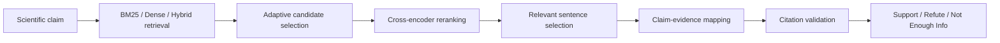

# Adaptive Retrieval and Evidence-Grounded Scientific Claim Verification

A CPU-compatible research project evaluating retrieval, reranking, adaptive candidate depth, and document-level evidence grounding on BEIR SciFact.

[Research paper](docs/RESEARCH_PAPER.md) · [Phase 5 report](docs/PHASE5_CONTROLLED_EXPERIMENTS_REPORT.md) · [Reproducibility](docs/REPRODUCIBILITY.md) · [Dataset protocol](docs/DATASET_AND_EXPERIMENTAL_PROTOCOL.md) · [Demo script](docs/PROJECT_DEMONSTRATION_SCRIPT.md)

## Research problem

Document retrieval answers “which documents are relevant?” Scientific claim verification asks a stricter question: “which exact evidence supports or refutes this claim, and when should the system abstain?”

This project separates:

- document retrieval relevance,
- claim-to-sentence relevance,
- support/refutation relationship signals,
- citation validation,
- final claim-verdict correctness.

The project does not present lexical overlap or rule-based relationship classification as validated scientific entailment.

## Objectives

- Compare BM25, Dense, and Hybrid retrieval.
- Compare fixed and adaptive candidate pools.
- Measure cross-encoder reranking and evidence-aware reranking.
- Implement exact source-traceable sentence extraction.
- Validate citations against original corpus text.
- Abstain for weak, conflicting, or invalid evidence.
- Freeze and execute a final CPU-only controlled protocol.
- Preserve every result and historical experiment artifact.

## Architecture



The implementation uses FAISS `IndexFlatIP`, a normalized MiniLM embedding model, BM25, reciprocal-rank fusion, a MiniLM cross-encoder, and local rule-based evidence components.

## Key results

### Phase 2 — 300 official development claims

| Approach | Hit@10 | Recall@10 | MRR@10 | MAP@10 | nDCG@10 |
|---|---:|---:|---:|---:|---:|
| BM25 | 0.7367 | 0.7229 | 0.5169 | 0.5015 | 0.5585 |
| Dense | 0.7967 | 0.7867 | 0.5979 | 0.5887 | 0.6402 |
| Hybrid | 0.8167 | 0.8011 | 0.5988 | 0.5893 | 0.6442 |

RRF sensitivity reached Hit@10=0.840 at c=10.

### Phase 3 — reranking and adaptation

- Cross-encoder reranking produced numerical development improvements, but broad corrected significance was not established.
- Dense score-gap adaptive retrieval processed 16.93 candidates/query with nDCG@10=0.690694, versus 50 candidates with nDCG@10=0.690648 for Dense fixed Top-50.
- Dense confidence adaptive retrieval processed 10 candidates/query with nDCG@10=0.683095.
- Hybrid evidence-aware Pool-50 achieved the highest observed Experiment C development nDCG@10 of 0.704115.
- The +0.010249 nDCG@10 advantage over cross-encoder reranking was not statistically significant after the declared correction.

### Phase 4 — evidence grounding

The pipeline provides:

- exact sentence extraction and source traceability,
- SUPPORTS, REFUTES, NEUTRAL, and INSUFFICIENT relationship classes,
- duplicate-citation handling,
- exact document/sentence/text validation,
- configurable abstention for weak, conflicting, or invalid evidence,
- Python integration through `EvidenceGroundingPipeline`.

The relationship mapper is a lexical/rule-based baseline, not a validated entailment model.

### Phase 5 — held-out execution

The frozen run `run_0010` processed 300 official held-out claim texts.

- Evidence-grounded abstention rate: 46.67%
- Mean end-to-end latency: approximately 23.50 seconds/query
- Evidence selection latency: approximately 12.51 seconds/query
- Citation validity/traceability: 100% among source-matched mappings

The official held-out `claims_test.jsonl` contains claim text only. It provides no relevance judgments, evidence annotations, or verdict labels. Held-out retrieval accuracy, verdict accuracy, F1, evidence coverage, and statistical superiority therefore cannot be calculated or claimed.

## Figures

| Figure | Preview |
|---|---|
| [System architecture](docs/figures/evidence_grounding_architecture.png) | End-to-end verification pipeline |
| [Retrieval comparison](docs/figures/retrieval_performance_comparison.png) | BM25, Dense, Hybrid at K=10 |
| [RRF sensitivity](docs/figures/rrf_sensitivity.png) | Hit rates across RRF constants |
| [Reranking findings](docs/figures/reranking_findings.png) | Experiment A pool-size comparison |
| [Adaptive efficiency](docs/figures/adaptive_retrieval_efficiency.png) | nDCG versus candidate processing |
| [Evidence workflow](docs/figures/evidence_grounding_workflow.png) | Sentence selection through abstention |
| [Evidence-aware findings](docs/figures/evidence_aware_findings.png) | Dense/Hybrid development nDCG |
| [Phase 5 latency](docs/figures/phase5_latency.png) | Controlled execution latency |

## Repository structure

```text
src/
  data/             split and corpus utilities
  retrieval/        BM25, Dense, Hybrid, rerankers, adaptive retrieval
  evidence/         selection, mapping, citations, verdict, pipeline
  evaluation/       retrieval, classification, and statistical utilities
  experiments/      run, artifact, and configuration management
experiments/        phase and controlled experiment runners
configs/            frozen and component configurations
manifests/          dataset and experiment manifests
tests/              focused unit and integrity tests
docs/               research reports, paper, protocol, and diagrams
docs/figures/       publication-style portfolio visualizations
results/runs/       historical and frozen experiment outputs
```

## Installation

```powershell
py -3.13 -m venv .venv
.\.venv\Scripts\Activate.ps1
python -m pip install -r requirements.txt
```

For full setup and command verification, see [Reproducibility Guide](docs/REPRODUCIBILITY.md).

## Testing

Run the core suite:

```powershell
.\.venv\Scripts\python.exe -m pytest -q
```

Run focused Phase 4/5 tests:

```powershell
.\.venv\Scripts\python.exe -m pytest -q tests/test_evidence_grounding.py tests/test_phase5_controlled.py
```

`tests/test_dataset_validation.py` is excluded from held-out execution because its split loader can inspect every official claim split.

## Reproduction

Phase 2:

```powershell
.\.venv\Scripts\python.exe experiments\run_retrieval_comparison.py
.\.venv\Scripts\python.exe scripts\generate_phase2_figures.py
```

Phase 3:

```powershell
.\.venv\Scripts\python.exe experiments\run_experiment_a.py --resume run_0006
.\.venv\Scripts\python.exe experiments\run_experiment_b.py --resume run_0008
.\.venv\Scripts\python.exe experiments\run_experiment_c.py --resume run_0009
```

Phase 5:

```powershell
.\.venv\Scripts\python.exe experiments\run_phase5_controlled.py --freeze-only
.\.venv\Scripts\python.exe experiments\run_phase5_controlled.py --resume run_0010
```

Phase 6 figures:

```powershell
.\.venv\Scripts\python.exe scripts\generate_phase6_figures.py
```

## Documentation

- [Complete research paper](docs/RESEARCH_PAPER.md)
- [Dataset and experimental protocol](docs/DATASET_AND_EXPERIMENTAL_PROTOCOL.md)
- [Reproducibility guide](docs/REPRODUCIBILITY.md)
- [Project demonstration script](docs/PROJECT_DEMONSTRATION_SCRIPT.md)
- [Phase 1 report](docs/PHASE1_REPORT.md)
- [Phase 2 report](docs/PHASE2_REPORT.md)
- [Experiment A report](docs/PHASE3_REPORT.md)
- [Experiment B report](docs/PHASE3_EXPERIMENT_B_REPORT.md)
- [Experiment C report](docs/PHASE3_EXPERIMENT_C_REPORT.md)
- [Phase 3 final summary](docs/PHASE3_FINAL_SUMMARY.md)
- [Phase 3 coverage audit](docs/PHASE3_COVERAGE_AUDIT.md)
- [Phase 4 report](docs/PHASE4_EVIDENCE_GROUNDING_REPORT.md)
- [Phase 5 report](docs/PHASE5_CONTROLLED_EXPERIMENTS_REPORT.md)

## Limitations and future work

- Development findings do not establish held-out superiority.
- Document-level evidence mapping is not validated entailment.
- Confidence values are heuristics, not calibrated probabilities.
- CPU latency is environment-dependent.
- The held-out claims file cannot support gold-standard accuracy evaluation.

Future work should include validated entailment models, calibrated uncertainty, formal citation verification, repeated latency measurement, and a labeled held-out benchmark with relevance judgments and claim verdicts.
